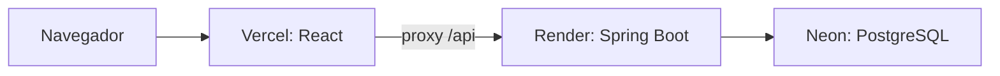

# Publicação — Vercel, Render e Neon

Revisão: **12/10/2026**, conforme os arquivos de configuração do repositório.
Valores de planos/preços não são requisitos da aplicação; confira-os no provedor
quando contratar. Este documento descreve a topologia e os contratos usados.

## Ambientes e topologia

| Parte | Ambiente conhecido |
| --- | --- |
| Frontend | https://estoq-oficial.vercel.app |
| Backend | https://estoq-backend-jv04.onrender.com |
| Banco | PostgreSQL no Neon; schema de negócio atual `public`. |
| Local | Vite com proxy `/api`; backend 8083; PostgreSQL Docker 5434. |

`frontend/vercel.json` encaminha `/api/:path*` ao backend e as rotas da SPA para
`index.html`. O navegador usa cookie de sessão no domínio do site, mantendo
CSRF e SameSite=Lax. Não configurar o cliente para chamar diretamente outro
domínio sem revisar esse contrato de autenticação.

## Backend

O `render.yaml` referencia branch main, `backend/Dockerfile`, deploy automático
e health check `/api/saude/vivo`, sem consulta ao banco. A imagem usa Java 21, gera o JAR e instala
cliente PostgreSQL e Tesseract em português. Não adicionar notas reais à imagem.

| Variável | Uso / padrão da publicação |
| --- | --- |
| `DATABASE_URL` | URL JDBC do banco correto, com TLS conforme o provedor; não publicar credenciais. |
| `DATABASE_USER`, `DATABASE_PASSWORD` | Credenciais configuradas no serviço. |
| `PORT` | 8080 no blueprint; o provedor fornece a porta de execução. |
| `SESSION_SECURE` | true em produção. |
| `SESSION_SAMESITE` | lax, usando o proxy. |
| `DDL_AUTO` | validate. |
| `FLYWAY_ENABLED` | true. |
| `SEED_ENABLED` | false em produção. |
| `API_DOCS_ENABLED` | false em produção. |
| `CORS_ORIGINS` | Vazio quando só há acesso pelo proxy; origens conhecidas no acesso direto autorizado. |
| `ESTOQ_BACKUP_DIR` | `/tmp/estoq-backups`, temporário. |
| `ESTOQ_BACKUP_HOST/PORTA/DB/SCHEMA/USER/PASS` | Overrides opcionais; conexão é derivada do datasource quando vazios. |
| `ESTOQ_BACKUP_MANTER` | Retenção padrão 7. |

O seed Java é exclusivo do profile **dev**. Habilitar `SEED_ENABLED=true` em
produção não cria usuários por si só. Cadastro de restaurante usa `/api/registro`;
provisionamento inicial de PLATAFORMA depende da situação da base e dos scripts
administrativos. Confira o perfil existente; não assumir que todo `admin@estoq.com`
é ADMIN operacional nem executar um INSERT antigo como procedimento universal.

## Migrações e schema

Flyway roda antes de o boot concluir. `ddl-auto=validate` confere o resultado;
não usar update para reparar produção. Não mudar checksum de migração aplicada.

| Arquivo | Papel |
| --- | --- |
| B4 | Baseline com schema completo para base nova. |
| V1–V3 | Evolução legada para restaurante/tenant e promoção de PLATAFORMA. |
| V4 | Receita base de CMV por período. |
| V5 | Revisões, itens e vínculos de importação fiscal. |
| V6 | Categorias padrão para restaurantes ativos sem categoria ativa. |

Em base nova, o Flyway considera o baseline B4 e as migrações posteriores; em
base legada, usa o histórico e as migrações incrementais. Testes de migração
validam os cenários de PostgreSQL. Não tratar B4 e V4 como o mesmo script.

Produção conhecida usa `public` e conexão sem `currentSchema`. Desenvolvimento
local pode usar `estoq_v2`. `scripts/provision-neon.sql` é referência de
provisionamento, não autorização para trocar o schema da base já publicada.

## Frontend e CI

Vercel: root `frontend`, build `npm run build`, saída `dist`, branch de produção
main. A URL do proxy está no `vercel.json`; se o backend mudar, altere o arquivo
e publique novamente. Rotas diretas como `/login` devem servir a SPA.

A CI ativa está em `.github/workflows/validacao.yml`: backend Java 21/OCR/testes,
frontend Node 24/build/Playwright. Use o fluxo dev/main e confira o SHA publicado.
Check Vercel pendente não significa commit não enviado; aguarde ou inspecione
os logs da publicação. Um commit apenas documental também pode disparar deploy.

## Verificação após deploy

1. Confira CI e estado de ambos os deployments, associados ao commit correto.
2. Abra `/login`, faça login e confira o nome do restaurante/perfil.
3. Verifique GET `/api/auth/csrf` e proxy; não expor o token nos logs públicos.
4. Em ambiente de teste, valide isolamento de duas lojas e bloqueio de usuário/restaurante desativado.
5. Confira balanço com versões, recuperação de conflito e SSE/reconexão.
6. Confira um horário real: 19:26 UTC deve aparecer como 16:26 no navegador da Bahia.

SSE passa pelo mesmo proxy. Eventos: conectado, heartbeat a cada dez segundos e
alteracao após commit. Conexão é renovada após um minuto. O header atual
`X-Estoq-Sincronizacao: 3` identifica o protocolo disponível. Não identifica
necessariamente a última correção ou SHA publicado.

Testes que criam restaurantes/movimentos devem rodar em ambiente próprio.
`scripts/e2e_validacao.sh` executa integração local com backend e PostgreSQL descartáveis. Não utiliza senha de produção nem cria restaurantes no site publicado.
Na produção, prefira verificação de leitura com sessão autorizada.

## Limitações e recuperação

Sessões, limite de login e eventos SSE são mantidos em memória de uma instância;
reinício pode exigir novo login. Não escalar para várias instâncias sem projetar
sessão compartilhada e distribuição de eventos. Cache é local à aba, restrito
à sessão, e não oferece operação offline.

A disponibilidade/cold start depende do plano contratado. Não confundir serviço
iniciando com erro do domínio. Antes de reimplantar, confira logs e saúde de
backend/banco/proxy. Erros 401/403 têm causas distintas de falha de rede.

Backup completo é exclusivo da PLATAFORMA e precisa ser guardado fora do disco
efêmero; detalhes em [BACKUP_E_RESTAURACAO.md](BACKUP_E_RESTAURACAO.md).

Para rollback, escolha uma versão compatível no histórico dos provedores.
Rollback do código não desfaz migração nem dados. Verifique compatibilidade do
schema e dos payloads antes de promover a versão anterior.

Os endpoints de saúde são `/api/saude/vivo` e `/api/saude/pronto`. Consulte [Neon e consumo](NEON_E_CONSUMO.md) para configurar o serviço existente sem manter o banco ativo por healthchecks. `pronto` é diagnóstico manual.
